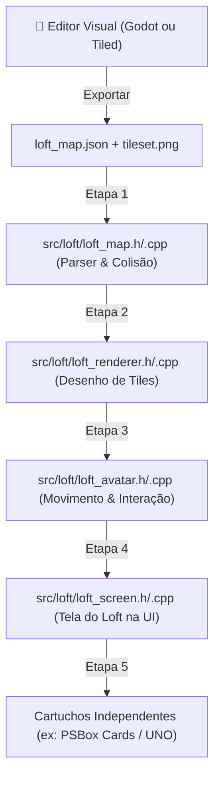

# 📜 Receita Passo a Passo: Desenvolvimento Modular do PSBox Loft
## Guia de Execução Autônoma para o Modelo Local (Qwen 3.8 27B / Bionic)

> [!IMPORTANT]
> **Como usar este documento com o Bionic**:
> O segredo para o modelo local ter **100% de sucesso e velocidade máxima** é o **escopo cirúrgico**.
> **NUNCA** peça o Loft inteiro de uma vez. Cada etapa abaixo contém:
> 1. O **Prompt Pronto** (copie e cole no Bionic no Desktop).
> 2. O **Arquivo Alvo** e suas dependências diretas.
> 3. O **Critério de Validação** para avançar para a próxima etapa.

---

## 🗺️ Visão da Arquitetura do Loft



---

## 🎨 Fase 0: Exportando o Mapa Visual (Godot ou Tiled)

### Opção A: No Tiled (Mais Direto)
1. Crie um mapa de **32x32 pixels** por tile (ex: 25 colunas x 18 linhas).
2. Crie as camadas de tiles:
   - `floor` (pisos, tapetes)
   - `walls` (paredes, balcões)
   - `decor` (quadros, luminárias)
3. Crie uma camada de objetos (`interactives`) e adicione retângulos onde ficam os pontos de interesse:
   - Propriedade `id`: `"uno_table"`, `"arcade_kart"`, `"trophy_wall"`, `"tv_console"`.
4. No Tiled: **Arquivo > Exportar Como > `loft_map.json`**.

### Opção B: No Godot 4.x (Com GDScript Exportador)
Se preferir desenhar no Godot, adicione este script simples para exportar o `TileMapLayer` para JSON:

```gdscript
# export_map.gd (Anexe a um nó na cena do mapa)
@tool
extends Node2D

@export var export_button: bool = false:
    set(val):
        if val: export_to_json()

func export_to_json():
    var floor_layer = $Floor as TileMapLayer
    var walls_layer = $Walls as TileMapLayer
    var map_rect = floor_layer.get_used_rect()
    
    var data = {
        "tileWidth": 32,
        "tileHeight": 32,
        "mapWidth": map_rect.size.x,
        "mapHeight": map_rect.size.y,
        "floor": [],
        "walls": [],
        "colliders": [],
        "interactives": [
            { "id": "uno_table", "tileX": 8, "tileY": 6, "name": "Mesa de Cartas" },
            { "id": "arcade_kart", "tileX": 15, "tileY": 4, "name": "PSBox Kart" },
            { "id": "trophy_wall", "tileX": 12, "tileY": 2, "name": "Mural de Troféus" }
        ]
    }
    
    for y in range(map_rect.position.y, map_rect.end.y):
        for x in range(map_rect.position.x, map_rect.end.x):
            var f_cell = floor_layer.get_cell_source_id(Vector2i(x, y))
            var w_cell = walls_layer.get_cell_source_id(Vector2i(x, y))
            data.floor.append(f_cell if f_cell >= 0 else 0)
            data.walls.append(w_cell if w_cell >= 0 else 0)
            data.colliders.append(1 if w_cell >= 0 else 0)
            
    var file = FileAccess.open("res://loft_map.json", FileAccess.WRITE)
    file.store_string(JSON.stringify(data, "  "))
    file.close()
    print("Mapa exportado com sucesso para loft_map.json!")
```

---

## 🍳 Etapa 1: Estruturas de Dados e Parser do Mapa

- **Arquivos a criar**: `src/loft/loft_map.h` e `src/loft/loft_map.cpp`
- **Dependências no projeto**: `util/json.h` (`xc::json::Value`, `xc::json::parse`)

### Prompt para colar no Bionic:
```text
Você é um desenvolvedor C++ sênior. Crie os arquivos `src/loft/loft_map.h` e `src/loft/loft_map.cpp` para carregar e gerenciar mapas 2D de tiles no projeto xCloud-PS5.

Requisitos:
1. Namespace: `xc::loft`
2. Estrutura `InteractiveObject`:
   - std::string id;
   - std::string name;
   - int tileX = 0, tileY = 0;
3. Classe `LoftMap`:
   - Métodos:
     - bool loadFromJson(const std::string& jsonString);
     - bool loadFromFile(const std::string& filePath);
     - bool isWalkable(int tileX, int tileY) const;
     - const InteractiveObject* getInteractiveAt(int tileX, int tileY) const;
     - int width() const;
     - int height() const;
     - int tileWidth() const;
     - int tileHeight() const;
     - const std::vector<int>& floorTiles() const;
     - const std::vector<int>& wallTiles() const;
     - const std::vector<InteractiveObject>& interactives() const;
4. Implementação do parser:
   - Use o parser JSON nativo do projeto: `#include "util/json.h"` (namespace `xc::json`).
   - Lógica de colisão: fora dos limites do mapa (tileX < 0 ou >= width, etc.) é NÃO-caminhável.
   - Se colliders[y * width + x] != 0, isWalkable retorna false.

Forneça o código completo e limpo para loft_map.h e loft_map.cpp.
```

✅ **Critério de Validação**: O código compila sem avisos e um teste simples lê um arquivo JSON e valida `isWalkable()`.

---

## 🍳 Etapa 2: Renderizador de Tiles na Tela

- **Arquivos a criar**: `src/loft/loft_renderer.h` e `src/loft/loft_renderer.cpp`
- **Dependências no projeto**: `ui/canvas.h` (`Canvas`, `Image`, `Rect`, `Color`) e `loft/loft_map.h`

### Prompt para colar no Bionic:
```text
Você é um desenvolvedor C++ sênior. Crie `src/loft/loft_renderer.h` e `src/loft/loft_renderer.cpp` para renderizar o mapa do Loft na tela usando a classe `Canvas` do projeto.

Requisitos:
1. Namespace: `xc::loft`
2. Classe `LoftRenderer`:
   - Construtor recebe referências ou ponteiros para `const LoftMap&` e a textura do tileset (`const ui::Image&`).
   - Método:
     - void render(ui::Canvas& canvas, int cameraX, int cameraY);
3. Otimização de Viewport (Culling):
   - Apenas desenhar os tiles que estiverem visíveis dentro dos limites da tela (canvas.width() e canvas.height()).
   - Converter coordenada de mundo do tile para coordenada de tela subtraindo cameraX e cameraY.
4. Desenho de Tiles:
   - Cada tile_id indica a posição no tileset (onde tileset_cols = tileset.w / tile_w).
   - Recorte da textura fonte: srcX = (id % cols) * tile_w, srcY = (id / cols) * tile_h.
   - Blitar o recorte do tile no canvas de destino. Desenhar camada de floor primeiro, depois walls.

Forneça loft_renderer.h e loft_renderer.cpp.
```

✅ **Critério de Validação**: O mapa aparece desenhado na tela perfeitamente alinhado em grade.

---

## 🍳 Etapa 3: Avatar, Física e Controles

- **Arquivos a criar**: `src/loft/loft_avatar.h` e `src/loft/loft_avatar.cpp`
- **Dependências no projeto**: `loft/loft_map.h`, `ui/canvas.h`, `ui/app_ui.h` (`NavInput`)

### Prompt para colar no Bionic:
```text
Você é um desenvolvedor C++ de jogos. Crie `src/loft/loft_avatar.h` e `src/loft/loft_avatar.cpp` para o personagem do jogador no PSBox Loft.

Requisitos:
1. Namespace: `xc::loft`
2. Enum `Facing`: Up, Down, Left, Right
3. Classe `LoftAvatar`:
   - Estado:
     - float x = 0.0f, y = 0.0f; // posição em pixels
     - Facing facing = Facing::Down;
     - bool isMoving = false;
     - float speed = 120.0f; // pixels por segundo
     - int frame = 0; // frame de animação (passo)
   - Métodos:
     - void update(float dtSeconds, const ui::NavInput& input, const LoftMap& map);
     - void render(ui::Canvas& canvas, int cameraX, int cameraY);
     - const InteractiveObject* checkInteraction(const LoftMap& map) const;
4. Física e Colisão:
   - O avatar possui uma caixa de colisão pequena nos pés (ex: 20x12 pixels).
   - Sliding collision: se tentar andar na diagonal e colidir com uma parede, ele ainda deve deslizar no eixo livre.
   - checkInteraction: verifica se há um objeto interativo a 1 tile de distância na direção em que o avatar está olhando.

Forneça loft_avatar.h e loft_avatar.cpp.
```

✅ **Critério de Validação**: O avatar se move com direcional/analógico, para contra paredes e detecta quando está de frente para um móvel.

---

## 🍳 Etapa 4: Tela do Loft (`LoftScreen`)

- **Arquivos a criar**: `src/loft/loft_screen.h` e `src/loft/loft_screen.cpp`
- **Integração**: Tela compatível com o loop de telas do xCloud-PS5 (`handleInput`, `render`, `update`).

### Prompt para colar no Bionic:
```text
Crie `src/loft/loft_screen.h` e `src/loft/loft_screen.cpp` para gerenciar a cena do PSBox Loft.

Requisitos:
1. Namespace: `xc::loft`
2. Classe `LoftScreen`:
   - Instancia `LoftMap`, `LoftRenderer` e `LoftAvatar`.
   - Câmera centralizada suavemente no avatar (com limites nas bordas do mapa).
   - Quando o avatar estiver próximo a um objeto interativo, desenha um balão de dica sobre a cabeça do avatar:
     Ex: "[X] Mesa de Cartas" ou "(A) Fliperama Kart".
   - Métodos:
     - bool init(const std::string& mapPath, const std::string& tilesetPath);
     - void handleInput(const ui::NavInput& nav);
     - void update(uint64_t nowMs);
     - void render(ui::Canvas& canvas);
     - bool wantsClose() const;
3. Saída:
   - Pressionar Botão Círculo / B ou OPTIONS fecha o Loft e retorna ao menu anterior.

Forneça loft_screen.h e loft_screen.cpp.
```

✅ **Critério de Validação**: Tela completa interativa abrindo e fechando com fluidez a 60 FPS.

---

## 🍳 Etapa 5: O Primeiro Cartucho de Minigame (PSBox Cards / UNO)

- **Arquivos a criar**: `src/loft/minigames/cards/uno_engine.h` e `uno_engine.cpp`
- **Código 100% Lógico**: Não depende de gráficos; apenas lógica pura em C++ de cartas!

### Prompt para colar no Bionic:
```text
Crie uma biblioteca lógica em C++ puro para o minigame de cartas "PSBox Cards" (estilo UNO), em `src/loft/minigames/cards/uno_engine.h` e `uno_engine.cpp`.

Requisitos:
1. Namespace: `xc::loft::cards`
2. Enums:
   - CardColor: Red, Blue, Green, Yellow, Wild
   - CardType: Number0_9, Skip, Reverse, DrawTwo, WildChoice, WildDrawFour
3. Struct `Card`: CardColor color; CardType type; int value;
4. Classe `UnoEngine`:
   - 2 a 4 jogadores (Jogador 0 = Humano, 1..3 = Bots).
   - Métodos:
     - void startNewGame(int numPlayers);
     - bool canPlayCard(int playerIndex, int cardHandIndex) const;
     - bool playCard(int playerIndex, int cardHandIndex, CardColor chosenWildColor = CardColor::Wild);
     - void drawCard(int playerIndex);
     - int currentPlayer() const;
     - bool isGameOver() const;
     - int winner() const;
     - const std::vector<Card>& getHand(int playerIndex) const;
     - Card topCard() const;
     - void updateBots(); // Executa o turno da IA com estratégia simples válida
5. Regras clássicas de descarte: mesma cor OU mesmo valor/símbolo OU coringa.

Forneça o código completo em C++ moderno e limpo.
```

✅ **Critério de Validação**: Suíte de testes rodando jogadas e declarando vencedor sem trapaças.

---

## 🚀 Resumo das Vantagens para o Seu Fluxo

| Benefício | Como Isso Ajuda Você |
| :--- | :--- |
| **Zero dependência de limites de nuvem** | Você pode desenvolver no Bionic no Desktop mesmo se acabar a cota semanal da API. |
| **Sem congelamentos do modelo** | Como cada prompt tem um escopo de 1 único módulo com regras explícitas, o Qwen 3.8 responde em segundos. |
| **Você é o Diretor Criativo** | Você desenha o mapa no Godot ou Tiled visualmente como achar mais bonito. |
| **Integração sem atrito** | Quando quiser juntar ao app do PS5/Android, basta me avisar que eu conecto o `LoftScreen` ao botão do menu principal. |
